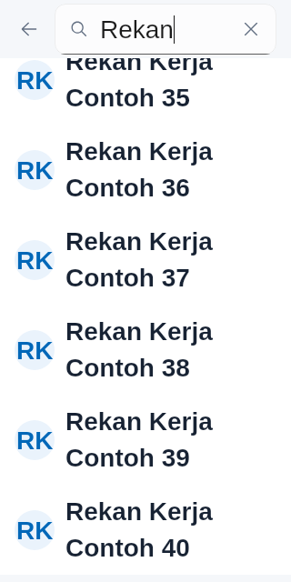
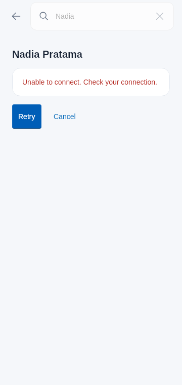

# Participant discovery and opening a DM

The Chat participant screen searches the currently admitted company directory and
opens a selected direct conversation through durable control commands. It shares
the encrypted conversation directory's access gate; no message body or provider
credential is used for search. Application DI registers the presentation module.
Service navigation, setup and the message thread are the next integration work.

## Discovery and local access

`ObserveCollaborationAccess` observes local account/company ownership and the shared
read-admission record without loading directory rows or message bodies. Ordinary
credential age does not remove that local ownership. The screen keeps this observer
while hidden and releases it when its ViewModel is cleared. Lost ownership or a
confirmed company restriction clears people and selection, cancels pending work,
and prevents a late navigation result.

Search waits for the initial local access result. An explicit entry can make one
live recovery attempt even when the initial company gate is closed. Re-entering
while the first local read is pending does not create another request. Editing the
query cancels the obsolete search and debounces the new request by 300 ms. Inputs
are bounded to the API's 80 UTF-16 units, avoid retaining a split surrogate
pair and replace control characters with spaces. A late, uncooperative old response
cannot replace the current results. Search is paged in explicit groups of 30;
previous cursors are bounded at 200 pages. A failed next-page attempt retains its
query/cursor for Retry and keeps Previous available.

`ReadCollaborationConversations` retains newly received company denials before
responding to cancellation. Failed persistence or later failed retries cannot
silently reopen content. A successful admitted read can clear only the gate revision
it observed before acquisition; a newer denial still wins. Directory-level denial
classification is separate from individual room/conversation failure. Rejecting one
resource does not by itself hide other owned conversations. Raw provider token
expiry also does not establish a company denial.

## Direct acquisition and durable Open

`RefreshCollaborationList.conversation` acquires the selected summary directly,
including a DM absent from the first list page. Individual and paged summaries
share the same publication mutex, owner checks and encrypted checkpoint CAS.
A different returned conversation ID cannot publish. Missing list rows are retained;
there is no scan of all participants or background pagination.

Selection is accepted only from the current owned page. The ViewModel prepares a
retained Open command, replays that exact operation, acquires its confirmed summary,
and reconciles the receipt against the observed owned peer pair/version before
navigation. Unverified reconciliation keeps the command and reports a retryable
failure. No device registration, room provisioning or SDK session is started here.

A lost Open response retries the same stored operation. Failure after confirmation
reuses that receipt without sending another Open. Stopping cancels active I/O while
retaining the selection for explicit continuation; account replacement clears it.
Cancellation cannot prove that the server did not commit, so cancelling selection
never deletes the retained command. A successfully acquired conversation remains in
the encrypted directory across process death, including after control retirement
and before navigation. Opening again after restart can use that owned directory.

## UI

Search occupies the app bar beside Back. The keyboard inset belongs to the page;
selecting a person clears input focus. Rows reuse the inbox's named, accessible
person action. A pending or failed Open keeps the selected name visible with progress
or Retry/Cancel; the search input is disabled until selection is cancelled. These
are operation actions, not persistent filter cards. The page is capped at 720 dp.

Common tests exercise bounded/debounced input, pending initial ownership, late
queries, denial recovery, pagination, exact operation reuse, confirmed replay,
interruption, account replacement and incorrect receipt targets. Compose tests
exercise narrow Indonesian text at 200%, stationary header/input while scrolling,
focus transfer, retry and selection cancellation. Fictional screenshot states do
not establish deployed chat service or native SDK interoperability. Continue the
accepted P0–P8 implementation; discovery alone accepts no complete PRD group.

[Validation and source hashes](measurements/chat-participants-2026-11-01.json)
record every attempt. Reviewed fictional states:

