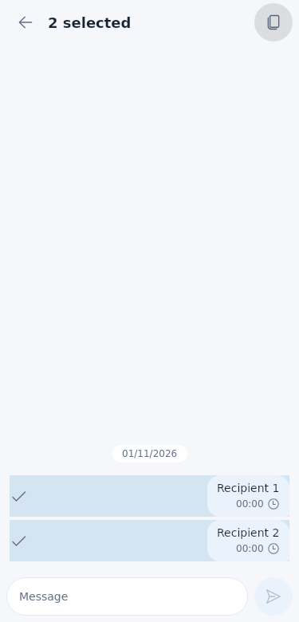
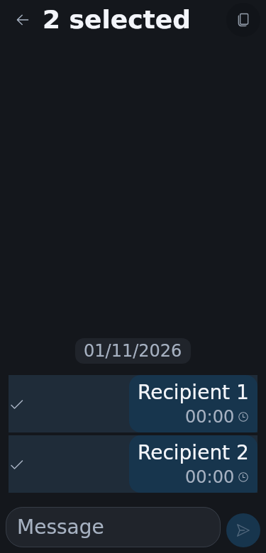
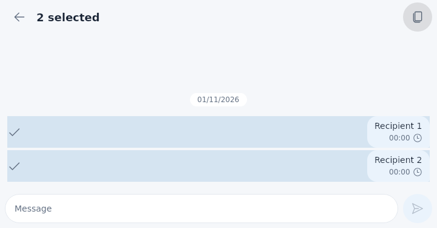
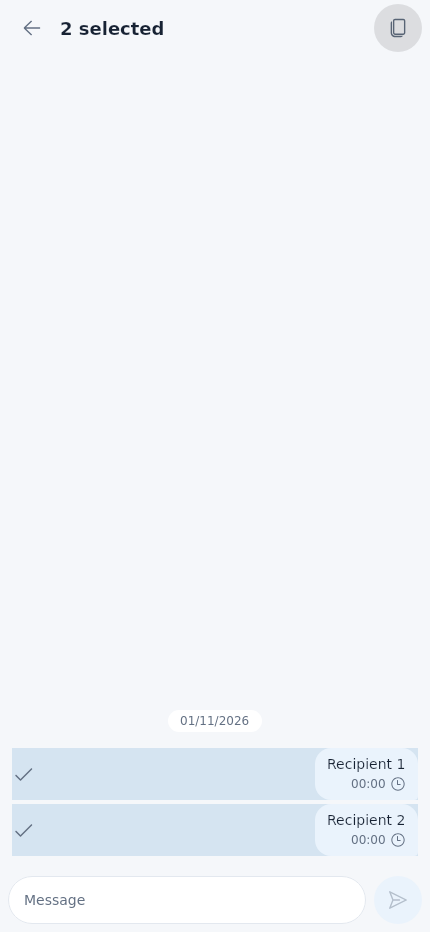
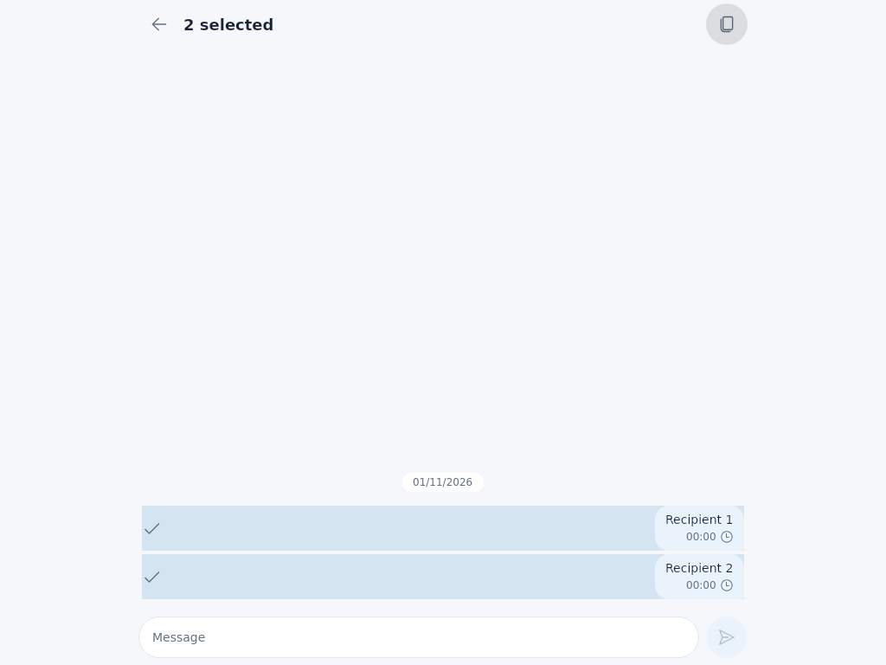

# Recipient conversation page

A recipient conversation renders the existing bubble, day-divider, quote and composer components directly from retained recipient state. The page carries typed recipient selections, accepts an already known peer display name, and keeps cached rows and draft input visible during an independent local read. Long press opens multiple selection and the implemented Copy action; no permanent selection control, network subtitle, refresh button or unsupported attachment action is added. Send remains enabled during independent local persistence, and the input keeps focus for later typing.

The quote component takes the actual local thread snapshot, so canonical and recipient pages share the same owned quote behavior without constructing a fake canonical state or conversation ID. A shared visual viewport in navigation composition accepts a stable message key and a bounded list owner. It follows a new bottom message in layout while preserving an older reading anchor. The existing canonical viewport remains a thin typed adapter, with its prior behavior under the same tests. The recipient page itself owns no state/effects; its real route must compose the shared viewport. The two recipient layout tests explicitly compose that navigation-owned viewport alongside the page. This is layout ownership only; no acquisition, permission, setup or transport is performed in composition.

Nine new desktop UI cases passed for compact, landscape, dark/2x-font, large-phone and centered-tablet selection, retained content while reading, newest-message placement in the first constrained frame, older-anchor retention, and input focus/typing after Send. Five screenshot artifacts were recorded by the tests and actually inspected. Canonical layout, focus and quote cases remain regression controls. These checks do not establish physical Android latency, real-route warm-entry behavior or Apple runtime acceptance.

This page is not an active product route. Actual root/contact/thread navigation must use the same bounded Group ownership, confirm Back and Copy effects immediately before navigation/clipboard I/O, preserve a single editor per route, and verify retained local preparation and readmission. Independent canonical/recipient drafts, global pending/draft inbox continuity and finite setup after retained Send remain required. Plain-text recipient drafts still lack outgoing reply/forward/delete operations. Phone93 and live services are unchanged; Group OFF, V117–140 undeployed, 54 PRD groups OPEN. Preserve blocked SQLite preparation, failed Apple evidence and protected stores. Generic foundation ports require independent Starter acceptance; no HRIS state/policy belongs in Starter.

The first focused attempt stopped at the architecture check because the shared viewport state/effect was initially placed under pages. No Kotlin/UI tests ran. The effect was moved to navigation composition, removed from the page, and composed explicitly in its layout test host; the architecture check remains unchanged.

Measured existing color-token limitation: light-mode muted timestamp #637083 on outgoing bubble #EAF3FC is 4.48:1, just below the 4.5:1 normal-text target. Body text is 14.26:1; dark timestamps are 5.86:1. The images were inspected, but this packet does not claim complete contrast acceptance. Correct the shared muted token and validate the reusable change in Mobile/Starter before the next product delivery.

Validation: 18,414 cases (2,264 fresh / 16,150 exact unchanged), preserving all 18,405 prior identities plus 9 executions. Focused 19 and full root/Android/browser/Apple-source gates passed.

Earlier focused attempts are preserved separately; only the accepted source/gates establish this result.

[Exact validation](measurements/collaboration-recipient-page-2026-11-14.json).

