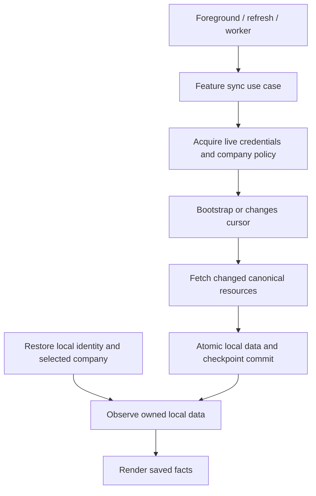
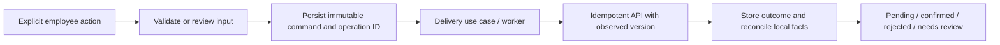

# Local-first reads and synchronization

For stored projections, the local database is the source observed by the UI. A
network response updates storage; an unavailable network does not make saved
facts unreadable. This follows [Now in Android's offline-first approach](https://github.com/android/nowinandroid/blob/main/docs/ArchitectureLearningJourney.md).
A change list reduces acquisition work, but does not by itself provide offline
startup, durable edits, or conflict handling.

## Read path

Inbox storage identity binds API audience, account and company independently of
the local session. Database operations still require the active session, so a late
request from the preceding login cannot mutate retained facts. Other feature
snapshots still use temporary session ownership until their collection migration.
Existing read snapshots use authenticated encryption; scope replacement cancels
their observers. Reading another account/company is never a fallback.
Local bootstrap does not await `/me`, token refresh or client-policy acquisition.
An unchanged workspace renewal does not replace the navigation graph.

Four different values have different jobs:

| Value | Meaning | When stale or expired |
| --- | --- | --- |
| Local owner | Which account/company may expose this stored data | A different owner cannot read it |
| `fetchedAt` / `refreshAfter` | Age of the last complete read model | Keep the facts; acquire newer data separately |
| Change cursor | Position in retained server history | Stage a new snapshot; keep the old published view until replacement |
| Credential / action review | Authority to send a request or confirm reviewed input | Pause that operation or request reauthentication/review |

Expired credentials return the localizable `client.authentication_required`
without deleting the local identity. Confirmed server revocation is different:
remove the affected projection and keep its presentation gated even if cleanup
fails. Known company restrictions still apply. An offline device cannot learn a
new server-side access change until it reconnects.

## Change feed

The backend records change references in the same transaction as business writes.
Its publication worker assigns ordered positions only to committed changes;
rolled-back transactions cannot advance a public cursor. Cursors are opaque,
scoped to the account/company/projection, and have finite server retention.
See the [server protocol](https://github.com/fajarxfce/hris-platform/blob/main/docs/synchronization.md).

Inbox already consumes this protocol. One run reads a bounded number of pages,
hydrates changed resources with bounded concurrency, reconciles versions and
tombstones, and atomically stores data with the next cursor. A failed hydration
cannot advance that cursor. Multiple UI/worker triggers share an execution owner.

Ordinary cursor expiry starts a staging generation. The previous published data
survives failed hydration and process restart. A successful complete replacement
switches the visible generation atomically. `sync_scope_changed` instead removes
the old authorization projection before rebuilding. Neither case silently
replays employee commands or loops indefinitely.

## Write path

The server remains authoritative for payroll, leave balances and workflow
transitions. A local pending command is not a confirmed business result. Response
loss preserves the original body and operation ID; a retry does not manufacture
a new action. Version conflicts need reconciliation rather than last-write-wins.

Current workflows have durable delivery after preparation. Full offline creation
of every draft is not implemented: some forms still need online policy/evidence
review before they can be prepared. Saving an unfinished local draft and
submitting it are separate capabilities.

## Current coverage

| Area | Local reads | Incremental sync |
| --- | --- | --- |
| Selected company | Encrypted selection, restored without an age limit | Foreground/worker revalidation |
| Inbox | Account-owned encrypted records survive a new login; list/detail share a published generation | Implemented |
| Attendance / calendar | Last recent/monthly/calendar snapshots | Snapshot acquisition; server feed not registered |
| Leave | Last selected overview and request detail | Server collections exist; mobile integration pending |
| Overtime | Last selected overview and request detail | Server collection exists; mobile integration pending |
| Payslips | Last selected list and detail | Server collections exist; mobile integration pending |
| Expenses | Last selected list and detail | Server collection exists; mobile integration pending |
| Local document files | Account/company-owned imports and completed downloads | Upload/download commands; catalog is online |
| Coworker directory / profile | Live reads | Not implemented |

A last-view snapshot does not imply that every month, employee or historical
request is available offline. Unfetched data needs acquisition. Browser bearer
keys remain memory-only, so offline reopening after page closure is not supported.

## Storage plan for additional projections

Each collection should have typed local records that can be queried independently
of the last opened page. The intended logical records are:

| Record | Identity and metadata |
| --- | --- |
| Feature facts, such as leave requests or attendance days | Audience/account/company, resource ID, server version and typed fields |
| Sync checkpoint | Scope/collection, active and staging generation, opaque cursor and last successful sync time |
| Unsubmitted draft | Scope, local draft ID and editable input |
| Outbox command | Scope, stable operation ID, immutable input, observed version and delivery outcome |

Facts and their processed checkpoint commit in one repository-owned storage
transaction. A worker cannot advance a cursor before the associated records are
durable. Drafts and pending commands remain separate from confirmed facts, so
optimistic UI cannot accidentally change a leave balance or finalized payslip.
These are the next collection boundaries, not a claim that every module already
has these tables.

## Next increments

1. Extend stable audience/account/company ownership to the remaining read
   projections. Inbox now retains account-owned facts across sign-in; workspace
   admission and other last-view snapshots remain session-owned. Reauthentication
   does not reuse an old request guard or old credential-bound feed cursor.
2. Add mobile projections for the existing leave, overtime, expense and payroll
   collections. Store independently versioned facts, then query/filter locally;
   replace single last-view slots only as each collection is implemented.
3. Register backend feeds for attendance, schedules, documents and coworker data,
   including deletions and authorization changes, before implementing mobile sync.
4. Persist unfinished local drafts separately from confirmed server models and
   prepared outbox commands. Show unsynchronized changes and actionable conflicts.
5. Exercise offline process restart after several days, expired credentials,
   interrupted bootstrap, duplicates, stale writes, revocation, cancellation and
   disposal for every added projection.
6. Show last successful sync, saved-data availability and pending changes
   consistently. Current pages retain facts with refresh feedback; a shared
   offline-status presentation is still pending.

Datasource contracts perform raw I/O. Repositories map/store facts and coordinate
datasources. Use cases coordinate repository contracts and own sync/action policy.
MVI owners observe local use cases and trigger finite work. This keeps the stricter
layer rules of this workspace instead of copying NIA's repository orchestration
literally. See [validation](validation.md) for checks actually performed.
