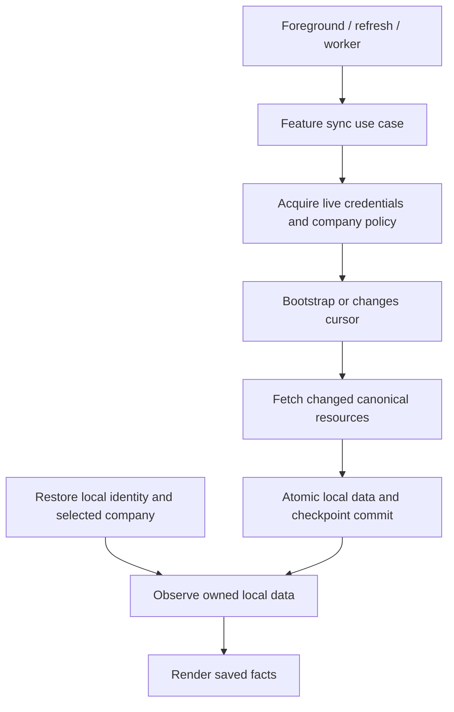
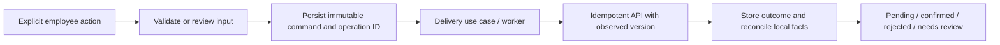

# Local-first reads and synchronization

For stored projections, the local database is the source observed by the UI. A
network response updates storage; an unavailable network does not make saved
facts unreadable. This follows [Now in Android's offline-first approach](https://github.com/android/nowinandroid/blob/main/docs/ArchitectureLearningJourney.md).
A change list reduces acquisition work, but does not by itself provide offline
startup, durable edits, or conflict handling.

NIA's [`changeListSync`](https://github.com/android/nowinandroid/blob/main/core/data/src/main/kotlin/com/google/samples/apps/nowinandroid/core/data/SyncUtilities.kt)
reads a saved collection version, fetches changed/deleted IDs, updates Room records,
and advances that version. Its news repository exposes queries from Room. HRIS
uses the same read-and-reconcile pattern with scope-bound opaque cursors, account
isolation, staged bootstrap, and records/checkpoint in one storage transaction.
Feature use cases own synchronization to follow this workspace's layer rules.

## Read path

Inbox, Leave, Overtime, Workforce, Payroll and Expense replica identity binds API audience,
account and company independently of the local session. Database operations still
require the active session, so a late request from the preceding login cannot
mutate retained facts. The retained directory and financial record scopes do not
change merely because credentials are renewed.
Existing read snapshots use authenticated encryption; scope replacement cancels
their observers. Reading another account/company is never a fallback.
Local bootstrap does not await `/me`, token refresh or client-policy acquisition.
An unchanged workspace renewal does not replace the navigation graph.

Four different values have different jobs:

| Value | Meaning | When stale or expired |
| --- | --- | --- |
| Local owner | Which account/company may expose this stored data | A different owner cannot read it |
| `fetchedAt` / `refreshAfter` | Age of the last complete read model | Keep the facts; acquire newer data separately |
| Change cursor | Position in retained server history | Stage a new snapshot; keep the old published view until replacement |
| Credential / action review | Authority to send a request or confirm reviewed input | Pause that operation or request reauthentication/review |

Action preparation reports a feature-specific `*_review_required` code when its
input needs current facts. It does not report that stored data has expired or
close an existing read projection. The localization boundary still accepts old
`*_cache_expired` codes retained in earlier command outcomes, with action-specific
copy. Ordinary reads never produce those codes. Export authorization and explicit
business deadlines remain separate from local data retention.

Expired credentials return the localizable `client.authentication_required`
without deleting the local identity. Confirmed server revocation is different:
remove the affected projection and keep its presentation gated even if cleanup
fails. Known company restrictions still apply. An offline device cannot learn a
new server-side access change until it reconnects.

## Change feed

The backend records change references in the same transaction as business writes.
Its publication worker assigns ordered positions only to committed changes;
rolled-back transactions cannot advance a public cursor. Cursors are opaque,
scoped to the account/company/projection, and have finite server retention.
See the [server protocol](https://github.com/fajarxfce/hris-platform/blob/main/docs/synchronization.md).

Inbox, Leave, Overtime, Workforce, Payroll and Expenses consume this protocol. One run reads
a bounded number of pages, hydrates changed resources with bounded concurrency,
reconciles versions and
tombstones, and atomically stores data with the next cursor. A failed hydration
cannot advance that cursor. Multiple UI/worker triggers share an execution owner.

Ordinary cursor expiry starts a staging generation. The previous published data
survives failed hydration and process restart. A successful complete replacement
switches the visible generation atomically. `sync_scope_changed` instead gates
the old authorization projection before cleanup and an admitted rebuild. Neither case silently
replays employee commands or loops indefinitely.

## Write path

The server remains authoritative for payroll, leave balances and workflow
transitions. A local pending command is not a confirmed business result. Response
loss preserves the original body and operation ID; a retry does not manufacture
a new action. Version conflicts need reconciliation rather than last-write-wins.

Current workflows have durable delivery after preparation. Expense editor input,
unfinished items and Leave creation input have encrypted local working copies,
independent of confirmed records and pending commands. Full offline creation of every draft is
not implemented: some forms still need online policy/evidence review before they
can be prepared. Saving an unfinished local draft and submitting it are separate
capabilities.

## Current coverage

| Area | Local reads | Incremental sync |
| --- | --- | --- |
| Selected company | Encrypted selection, restored without an age limit | Foreground/worker revalidation |
| Inbox | Account-owned encrypted records survive a new login; list/detail share a published generation | Implemented |
| Attendance / calendar | Account-owned daily evidence, effective schedule assignments, roster overrides and holidays; local month/week/employment queries | Four explicit collections, staged bootstrap and incremental changes implemented |
| Leave | Account-owned balances, full requests and acquired activity pages; local employment/year/status and history queries | Request/balance change feed and resumable older-activity acquisition implemented |
| Leave editor | Account/company/employment-owned dates, type, portion, reason and exact attachment metadata; local compare-and-set autosave | Explicit submission requires current review and an immutable command; confirmed cleanup removes only its matching draft revision |
| Overtime | Account-owned full requests and acquired activity; local employment/date/status queries | Request change feed and resumable older-activity acquisition implemented |
| Payslips | Account-owned full payslips, indexed annual summaries and versioned payment progress; local year/page/detail queries | Two explicit collections, revised heads, independent balances and staged format upgrades implemented |
| Expenses | Account-owned complete claims, indexed summaries, payment progress and acquired activity; local employment/month/status/page queries | Two explicit collections, canonical claim acquisition and resumable activity backfill implemented |
| Expense editor | Account/company-owned draft fields, completed lines and one unfinished item; local compare-and-set autosave | Explicit server Save performs fresh review and retains an immutable command; working copies do not replicate as confirmed claims |
| Published documents | Account-owned metadata with local employment/category/page queries | `DOCUMENT_EVIDENCE`, canonical published records and versioned withdrawals |
| Local document files | Account/company-owned imports and completed downloads | Resumable upload commands; download/export independently reauthorize content |
| Coworker directory | Account-owned encrypted records; full local search and department/page selection | `DIRECTORY_EMPLOYEES` |
| Private profile | Account-owned encrypted employment, person and assignment snapshots; local employment selection | `SELF_PROFILES`, coherent canonical records and versioned withdrawals |

A last-view snapshot does not imply that every month, employee or historical
request is available offline. Unfetched data needs acquisition. Browser bearer
keys remain memory-only, so offline reopening after page closure is not supported.

## Storage plan for additional projections

Each collection should have typed local records that can be queried independently
of the last opened page. The intended logical records are:

| Record | Identity and metadata |
| --- | --- |
| Feature facts, such as leave requests or attendance days | Audience/account/company, resource ID, server version and typed fields |
| Sync checkpoint | Scope/collection, active and staging generation, opaque cursor and last successful sync time |
| Unsubmitted draft | Scope, local draft ID and editable input |
| Outbox command | Scope, stable operation ID, immutable input, observed version and delivery outcome |

Facts and their processed checkpoint commit in one repository-owned storage
transaction. A worker cannot advance a cursor before the associated records are
durable. Drafts and pending commands remain separate from confirmed facts, so
optimistic UI cannot accidentally change a leave balance or finalized payslip.
These are the next collection boundaries, not a claim that every module already
has these tables.

### Leave replica

The physical store uses `replica_documents` with an account owner, company partition,
generation, record ID, version, ordering key and encrypted payload. Request summaries,
current detail components, activity pages and balances are independent documents.
A small encrypted directory document supplies
employment choices; it does not contain the request history. Room's indexed tag table
and IndexedDB's multi-entry index support local filtering without loading the whole
collection into memory. Filter tokens are derived with HMAC and bound to the API,
account, company, employment and filter. Ciphertext authenticates the ordering and
tag metadata too. Index equality/order still reveal structural metadata.

`ObserveLeave` resolves a selection from the stored employment directory, then reads
the requested balance and request pages. It only combines metadata and pages from
the same published generation/revision. Status changes, paging and year selection
do not trigger HTTP calls. Balances use the selected year; requests cover all dates.

`SyncLeave` selects `LEAVE_REQUESTS,LEAVE_BALANCES`, hydrates references four at a time,
and commits each processed page with its cursor and directory metadata. Eight
references per page, ten pages per run and a 30-second run deadline bound one job;
subsequent invocations resume its stored cursor. These limits do not discard acquired
history or expire local reads. Canonical versions can be newer than their reference;
older updates cannot overwrite them, and deletes remain versioned tombstones.
An unfinished publication honors the server's polling hint. A completed run leaves
idle scheduling to the platform worker, so explicit refresh and foreground recovery
do not wait on an old idle polling deadline.

Canonical reads may conceal lost ownership as `leave_request_not_found` or
`leave_account_not_found`. These invalidate the admitted projection rather than
inventing a deletion or treating the denial as an offline transport failure.
Balance type labels are hydrated with their financial record; standalone type
renames still need a metadata invalidation feed to update an unchanged balance.

The previous last-view overview remains a migration fallback until the first
complete replica is published. Once that replica completes, an empty local result
is authoritative; it does not recover an unrelated old filter page. The preceding
request snapshot remains a read-only compatibility source until the expanded
request format publishes. Its old writer exists only in migration test fixtures.

Leave record format 3 also hydrates optional carried-balance accounting without
inventing a newer ledger version. Its replacement generation retains the published
format-2 facts until complete. A failed or cancelled upgrade resumes that same
staging generation after restart. Calendar validity remains business metadata;
passing its date neither deletes local history nor rewrites the stored total.

Leave read admission is stored separately from its facts. Confirmed MFA, scope
and access denials remain authoritative through failed data cleanup and retries.
A process-owned buffer covers pending or failed admission writes; persisted
denials also survive account reauthentication. Only complete, current Leave sync
started after the latest denial can reopen the projection. Individual request
reads, type lookup and preview cannot clear it. Explicit detail/form retries
check whether recovery is needed before acquiring their own data.

Full request acquisition writes the summary, header, date chunks and latest activity
page together. Date chunks contain at most 128 entries and an activity page at most
ten changes; requests are retained by ID, independently of the last opened page.
A fresh individual read can initialize those records before list synchronization.
That initial projection has no completed-feed timestamp or invented directory.
An existing published generation remains protected while a replacement is staged.

After feed catch-up, `SyncLeave` fills at most eight pending activity pages per run.
Each request's strictly decreasing cursor advances atomically with its acquired page.
Already acquired pages are reused locally. A newer server request waits for its
change-feed update instead of advancing an older frontier. Request-version and
acquisition checks reject superseded work. Neither older activity nor an unrelated
checkpoint update renews the request's action-review timestamp.

`LoadLeaveRequest` serves cached activity navigation without HTTP or waiting for the
shared acquisition mutex. Explicit refresh, entry and action reconciliation acquire
current facts; combining latest and older responses requires matching request
versions. Queries verify the current parent before exposing components or older
pages, so stale date chunks and children of deleted requests cannot reappear.
The same mutex covers UI and worker acquisition, and deadlines include lock wait.
Storage compare-and-set conflicts do not revoke permission to read saved facts.

### Overtime replica

Overtime uses the same account owner and transaction contract, with separate
summary, current request and older-activity records. `SyncOvertime` selects
`OVERTIME_REQUESTS`; the current account's minimal employment directory remains
independent of People or calendar permissions. Explicit collection selection
supports existing own-resource read grants without widening the feed to coworkers.

Summaries use company work date and resource ID as the stable order. One HMAC-tagged
query reads at most 21 records for a selected employee/status, starting at the
requested date or local continuation. Date ordering bounds the query to one page;
rows past the selected end date are discarded. A 62-day filter window is a query
constraint, not a retention limit. Other months stay stored independently.
The preceding remote UUID continuation resets to the first local page during migration.

`LoadOvertimeRequest` and `SyncOvertime` share the feature's acquisition mutex and
30-second deadline, including lock wait. A fresh request writes current facts,
summary and any selected older activity atomically. Cached history navigation
bypasses HTTP and the mutex. Current facts retain their original credential/action
review metadata; reading older history cannot renew it.

Bootstrap, account replacement, versioned deletion and historical acquisition use
the same safeguards described for Leave. Eight feed references, four concurrent
canonical reads, ten feed pages and at most eight older-activity pages bound one
run. A saved frontier resumes unfinished history. Failed acquisition never advances
its cursor; a newer canonical version first waits for feed reconciliation.
An acquired legacy request/history page remains a read-only migration source until
its replacement is available. A completed feed's missing parent is authoritative.

## Next increments

1. Extend stable audience/account/company ownership to the remaining read
   projections. Inbox, Leave, Overtime, Workforce, Payroll and Expense replicas retain
   account-owned facts across sign-in; workspace admission and other last-view
   snapshots remain session-owned. Reauthentication
   does not reuse an old request guard or old credential-bound feed cursor.
2. Extend unfinished local draft persistence beyond Expenses and Leave, separately from
   immutable prepared commands and acquired server records.
3. Register the remaining document feeds,
   including deletions and authorization changes, before implementing mobile sync.
4. Keep unsynchronized changes and actionable conflicts clear in each migrated
   editor. Expense autosave distinguishes acknowledged local input from server Save.
5. Exercise offline process restart after several days, expired credentials,
   interrupted bootstrap, duplicates, stale writes, revocation, cancellation and
   disposal for every added projection.
6. Show last successful sync, saved-data availability and pending changes
   consistently. Current pages retain facts with refresh feedback; a shared
   offline-status presentation is still pending.

Datasource contracts perform raw I/O. Repositories map/store facts and coordinate
datasources. Use cases coordinate repository contracts and own sync/action policy.
MVI owners observe local use cases and trigger finite work. This keeps the stricter
layer rules of this workspace instead of copying NIA's repository orchestration
literally. See [validation](validation.md) for checks actually performed.

### Workforce replica

Attendance days, effective weekly assignments, roster overrides and company holidays
share one published company replica. `SyncWorkforce` explicitly selects their four
collections. Its 32-reference pages, four concurrent canonical requests, ten-page
run limit and 30-second deadline bound work without discarding acquired history.
The directory is independent of People availability and limited to owned employment.

Local month/week filters query four authenticated indexes, including the effective
schedule baseline before the selected range. Pure domain policy resolves the weekly
calendar from those records. The month/week window limits a query, not retention.
The preceding one-year calendar restriction and last-view-only attendance storage
no longer determine which acquired dates can be read.

A separate encrypted admission record carries confirmed read denials across Home,
Attendance and calendar. A failed disk write keeps the restriction in a process-owned
buffer; a successfully written denial also survives process restart. An acquisition
must have observed that denial before starting and complete successfully before it
can reopen the projection. Freshness, normal credential expiry and cursor retention
never create this denial. See [Workforce](workforce.md) for ownership, schedule policy,
command reconciliation and pre-upgrade compatibility.

### Payroll replica

Payslips and payment progress use separate account-owned records under
`payroll-replica/{company}`. Small summaries have a keyed year index; a list query
reads twenty-one records, while a detail query reads its payslip and payment
progress together. No selected-page snapshot replaces this history.

`SyncPayroll` owns two-collection acquisition for UI and worker triggers, with
bounded concurrency, cursor progress and cancellation. It commits records and
cursor atomically, keeps the published generation through ordinary cursor
replacement, and persists confirmed read denials under `payroll-access/{company}`.
A changed payment does not rewrite the immutable salary breakdown. See
[employee payslips](payroll.md) for request, storage and export ownership.

## Expense records

The [expense replica](expenses.md) stores canonical claims and separately versioned
reimbursement progress. Approval invalidations hydrate the current record even
when its base claim version is unchanged. Record chunks share an authenticated
acquisition identity, and summaries carry local employment/month/status indexes.
The change cursor advances in the same transaction as its records.

Claim and activity navigation reuse local storage. Activity-only acquisition and
payment-only updates do not renew action-review authority. Background history
acquisition is bounded and resumes from each claim's frontier. Filter changes do
not create HTTP requests or interrupt an active sync. Read denials persist across
routes and process restoration, independently of cleanup and ordinary freshness.

## Coworker directory

`SyncCompanyDirectory` consumes the explicit company-public directory collection.
Its record and cursor transaction publishes complete bootstrap replacements only
after catch-up, while retaining the preceding generation. Local observation reads
all acquired records for name/number search and department selection; visiting a
page is not a prerequisite. No time-to-live hides the directory. Stored ownership
uses account, company and API audience; the current session gates I/O and commits.
Confirmed read denials, canonical withdrawal, cursor retention and routine refresh
scheduling are handled separately. See [People](people.md#coworker-directory).

## Private profile

`SyncSelfProfiles` acquires the explicit owned-profile collection. Canonical records
combine employment, private person fields and organization/manager references in
one server snapshot. A separate aggregate revision drives the feed; command versions
remain unchanged. The encrypted replica commits records with its cursor and stages
initial/replacement publication. Employment selection queries acquired records
locally without a page visit or live credential renewal. Neither facts nor selection
expire with age. Account, company and audience ownership, confirmed access/MFA
denials and server withdrawals remain explicit gates. See [People](people.md#private-profiles).
