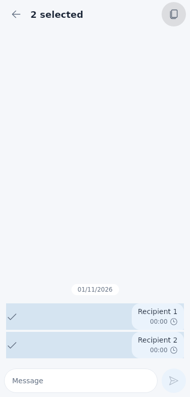
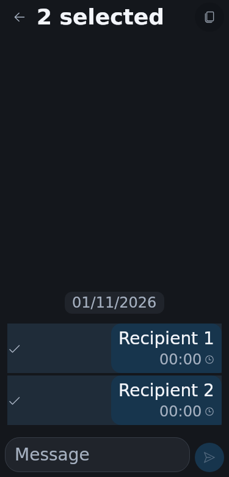
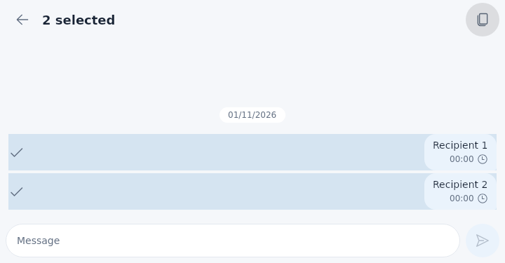
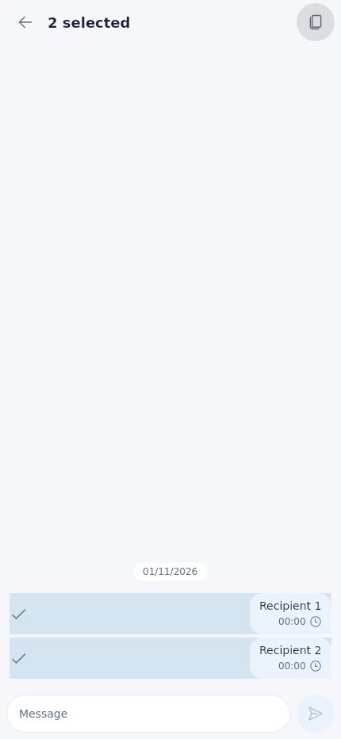
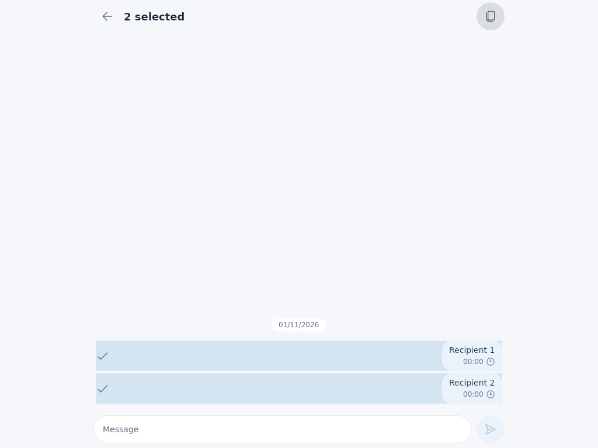

# Shared muted-text contrast

Light-mode muted text changes from #637083 to #626F82. On the existing outgoing bubble tint
#EAF3FC, contrast rises from 4.48:1 to 4.55:1, meeting the 4.5:1 normal-text target. The new
token is 5.10:1 on white and 4.75:1 on the canvas. Dark colors, typography and spacing are
unchanged. This is one generic design-system token; no HRIS or Matrix policy is added.

Existing layout tests passed in compact, large-phone, landscape, dark/2x-font and centered-tablet
profiles. All five fresh screenshots were actually viewed, and rendered token pixels were
checked. This verifies these foreground/background pairs, not every UI contrast combination.
No tests repeating color constants were introduced for this low-impact visual adjustment.

Validation: 18,436 preserved cases (2,581 fresh / 15,855 exact unchanged), with zero new test identities. Focused 15 and full root/Android/browser/Apple-source gates passed. Source e4d843e31a0a32a3955ef55ced5d6ef3d89a4b0d1d6311490742fa7f9332af7e; reports 7890692d0d263b470c2d3da440f2864f236eb1ae11393a59f406fd109e6d6338.

Starter port [5b732ddc](https://github.com/fajarxfce/compose-fluent-starter/commit/5b732ddc934b6cd0c86ba95a27f4eb44e986a7fc) is pushed and independently validated: 1,060 preserved cases (96 fresh / 964 exact unchanged), three Android variants/lint, production Web/browser and Apple source compilation. Phone93 is unchanged and no new APK
was installed. Group OFF; V117–140 undeployed; all 54 PRD acceptance groups remain OPEN.
Recipient feature navigation 303929a5 is accepted, but owned contact labels, application routing,
independent drafts, inbox continuity and finite setup still precede product activation.

[Exact validation](measurements/muted-text-contrast-2026-11-15.json).

